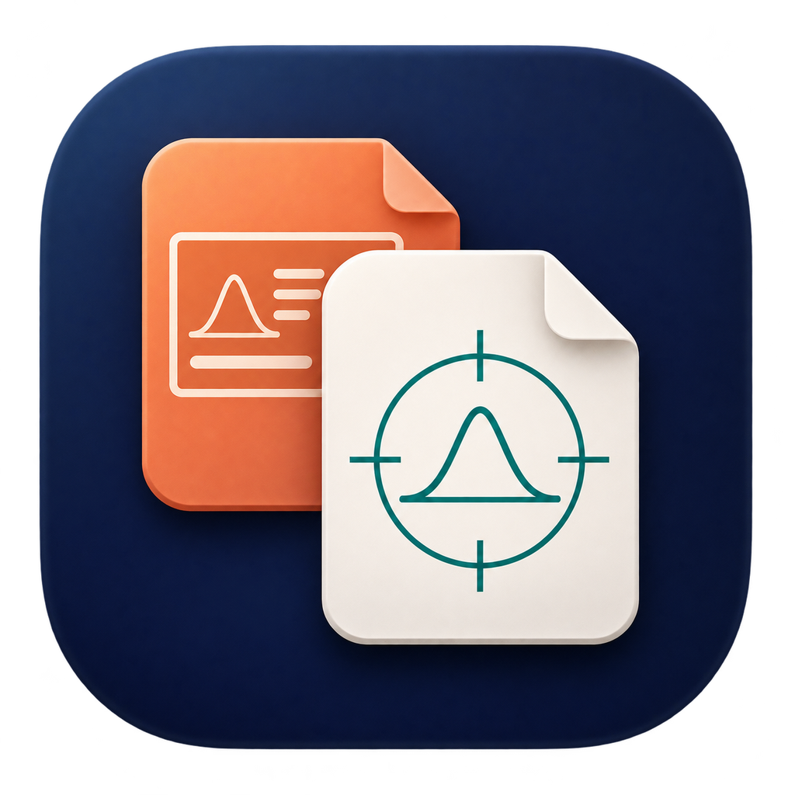

# PPTX Precise for Mac



**PowerPoint-native PDF export with verified source-image restoration.**

一个在本机运行的 macOS PPTX → PDF 工具。使用 Microsoft PowerPoint 的原生排版引擎导出，再通过 pypdf 和 Pillow 恢复能够准确匹配的原始图片，并校验输出。支持双击、拖放、批量转换和命令行。

[下载桌面版](https://github.com/winbeau/pptx-precise-mac/releases/latest) · [MIT License](LICENSE) · [更新记录](CHANGELOG.md)

> **需要安装 Microsoft PowerPoint for Mac。** 本项目源码使用 MIT 协议，渲染引擎仍是 PowerPoint。它不是一个完全独立的开源 PPTX 渲染器，也不保证所有特殊效果都能无损转换。

## 下载与使用

1. 在 Releases 下载 `PPTX-Precise-v1.1.0-macOS-arm64.zip` 并解压。
2. 打开 `PPTX Precise.app`，点击“选择 PPTX”，选择一份或多份已保存的文件，再选择保存位置并点击“转换为 PDF”。也可把 PPTX 或文件夹拖到应用图标上。
3. 输出同名 PDF 和一份字节相同、保持可编辑的 PPTX。输出到源目录时不会重写源 PPTX。

桌面版内置 Python、pypdf 和 Pillow，不需要安装 Python、Homebrew 或 Codex。当前预编译包面向 Apple Silicon（macOS 11+，且需使用兼容当前系统的 PowerPoint）；Intel Mac 可运行源码，或在 Intel Mac 上自行构建。

应用采用本地临时签名，尚未通过 Apple Developer 公证。若 macOS 阻止打开，请按系统的“仍要打开”流程允许本地应用运行。

首次使用可能出现两种系统提示：

- 允许应用控制 **Microsoft PowerPoint**，用于本地导出。
- PowerPoint 请求访问工具专用的 `~/Library/Application Support/PPTX-Precise/Work` 目录：点击 **Select…**，选择 **Work**，再点击 **Grant Access**。固定目录使后续转换通常无需再次授权。

不需要辅助功能权限。转换不会把文档上传到网络。

## 保真方式

| 内容 | 处理方式 |
| --- | --- |
| 排版、文本、公式与矢量 | PowerPoint 原生导出；后处理核对页面及嵌套 Form 绘图指令与文本不变 |
| 原始图片 | 在同一页内保守匹配整图，以 Flate 无损压缩写回完整源像素，并逐像素验证 |
| 字体 | 记录 PDF 中的字体及其嵌入状态；不自动替换或安装字体 |
| 尺寸与页数 | 与源 PPTX 校对；不改变页面大小，不自动缩放成 7 inch |
| PPTX | 从同一份已保存快照复制，保留原有编辑能力 |

“图片无损”是指被成功匹配和恢复的源像素。恢复范围是幻灯片直接引用的、不透明 RGB 或灰度位图。透明、复杂裁切、滤镜、母版背景、纹理填充、链接图片及 PowerPoint 自动栅格化的效果沿用原生结果，可能无法恢复原始图像或矢量。

匹配存在歧义时不猜测。报告会列出已识别但未恢复的图片；`--strict-images` 会拒绝发布这些文件。此选项只验证已识别的图片对象，不是对 PPTX 全部功能的完整保真证明。字体缺失导致的替换仍需安装原字体后重新导出。

## 文件保护与校验记录

转换使用唯一命名的独立快照，只关闭工具自己打开的临时演示文稿。用户已经打开的源稿存在未保存修改时会提示先保存；转换期间检测到源文件变化，也会停止发布该文件。

同名输出自动备份至 `.pptx-precise-backups/`。每次的 JSON 校验记录保存在 `.pptx-precise-reports/`，包含源文件、原生 PDF、最终 PDF 的 SHA-256，图片像素校验、字体、页数与尺寸。Finder 可用 **⌘⇧.** 显示隐藏目录。

每份文件通过校验后才发布。一个批次中后续文件失败，不会撤销先前已经成功的文件；可在处理错误后重新运行。

## 命令行

发行包内的 `run.command` 优先使用应用内置运行环境：

```bash
./run.command /path/to/Fig_1_7inch.pptx /path/to/Fig_5_7inch.pptx \
  --output /path/to/figures --copy-pptx --overwrite --strict-images
```

输入也可以是文件夹，程序会处理其中的 PPTX，忽略 Office 的 `~$` 临时文件，不递归扫描子目录。不同输入存在同名文件时会拒绝导出。

| 参数 | 含义 |
| --- | --- |
| `--output DIR` | 必需，输出目录 |
| `--copy-pptx` | 同时复制完全相同的源 PPTX |
| `--overwrite` | 先备份，再替换已有输出 |
| `--strict-images` | 已识别位图未全部恢复时停止发布 |
| `--timeout 300` | 每份原生导出的超时秒数，默认 300 |
| `--version` | 查看版本 |

诊断时可用 `--native-pdf-dir DIR` 提供已手工导出的同名 PDF。这个模式只核对页数与尺寸，无法证明 PDF 和 PPTX 来自相同内容版本，不适合作为常规转换入口。

## 运行源码

需要 macOS、PowerPoint 和 Python 3.10+（构建桌面应用另需 Xcode Command Line Tools）：

```bash
git clone https://github.com/winbeau/pptx-precise-mac.git
cd pptx-precise-mac
python3 -m venv .venv
.venv/bin/python -m pip install -r requirements.txt
./run.command /path/to/input.pptx --output /path/to/output
```

也可以使用随附的 `安装依赖.command`，它会建立用户级虚拟环境并从 PyPI 安装依赖。

## 测试与构建

```bash
.venv/bin/python -m unittest discover -s . -p 'test_*.py' -v
.venv/bin/python -m pip install 'pyinstaller>=6,<7'
.venv/bin/python build_macos.py --dist ./dist --work ./build
```

构建脚本生成包含运行环境的 `.app`、命令行入口、源码和依赖许可证。输出目录必须为空。构建架构与所用 Python 一致；最低 macOS 版本取决于 Python 及所有打包动态库，发布前须核对 Mach-O 的 `minos`，不要默认 Homebrew Python 可兼容旧系统。

单元测试使用合成文档，覆盖像素恢复、歧义与裁切拒绝、尺寸不符、并发修改源文件保护、同名输入拒绝和覆盖备份。CI 不包含需要已授权 PowerPoint 的桌面端到端测试；发布前需在 Mac 上实际转换并检查 PDF。

如果导出超时，先检查 PowerPoint 是否有文件访问或修复弹窗，处理后重试。不要在导出过程中修改源稿。

## 开源方案与许可

- [LibreOffice PDF 导出参数](https://help.libreoffice.org/latest/en-US/text/shared/guide/pdf_params.html)支持 `UseLosslessCompression=true` 和 `ReduceImageResolution=false`。这些参数控制图片压缩与降采样，不能证明它的 PPTX 排版与 PowerPoint 完全一致。
- 本项目选择 PowerPoint 作为排版引擎，使用 [pypdf](https://github.com/py-pdf/pypdf) 和 [Pillow](https://github.com/python-pillow/Pillow) 做本地后处理，使用 [PyInstaller](https://github.com/pyinstaller/pyinstaller) 打包。
- 项目源码采用 [MIT License](LICENSE)。发行包中的第三方软件遵循各自许可证，见 `licenses/`；MIT 授权不包含 Microsoft PowerPoint。
